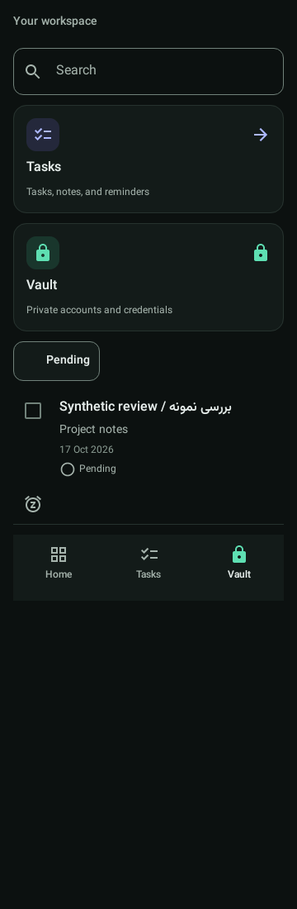
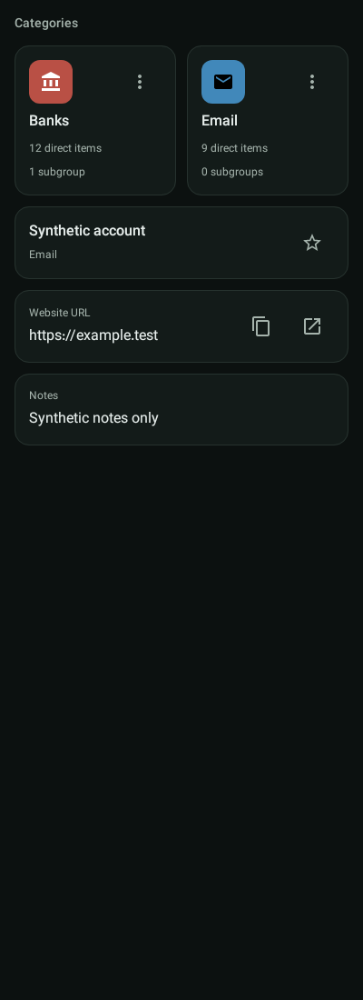
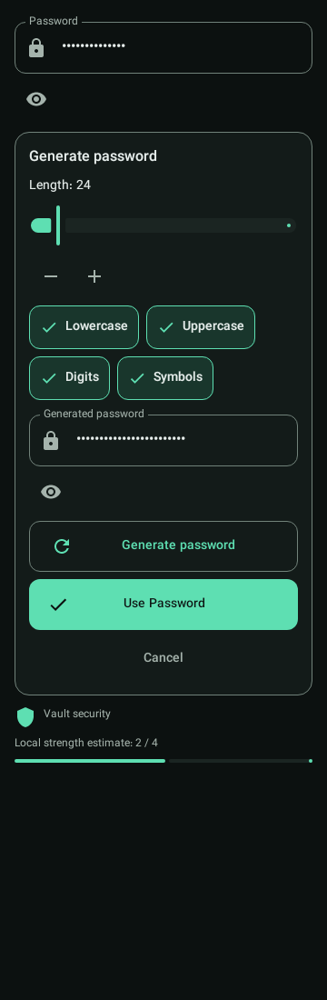
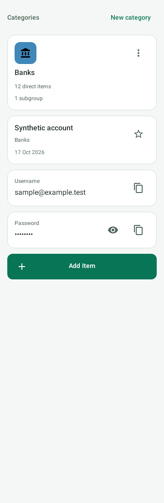
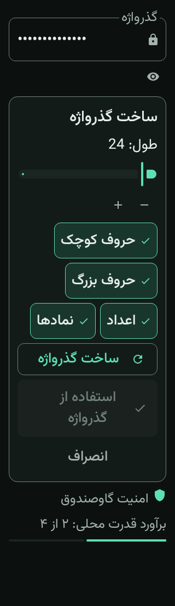
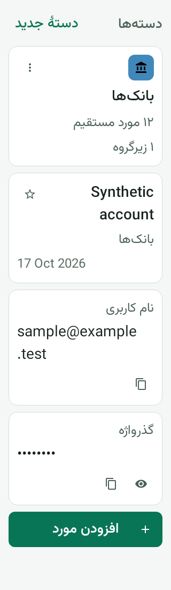
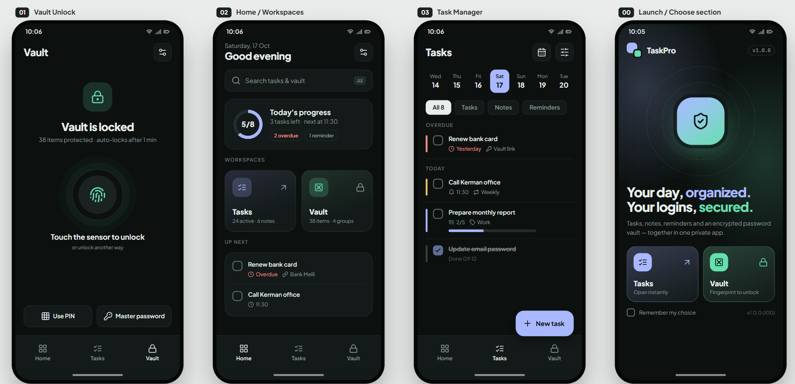
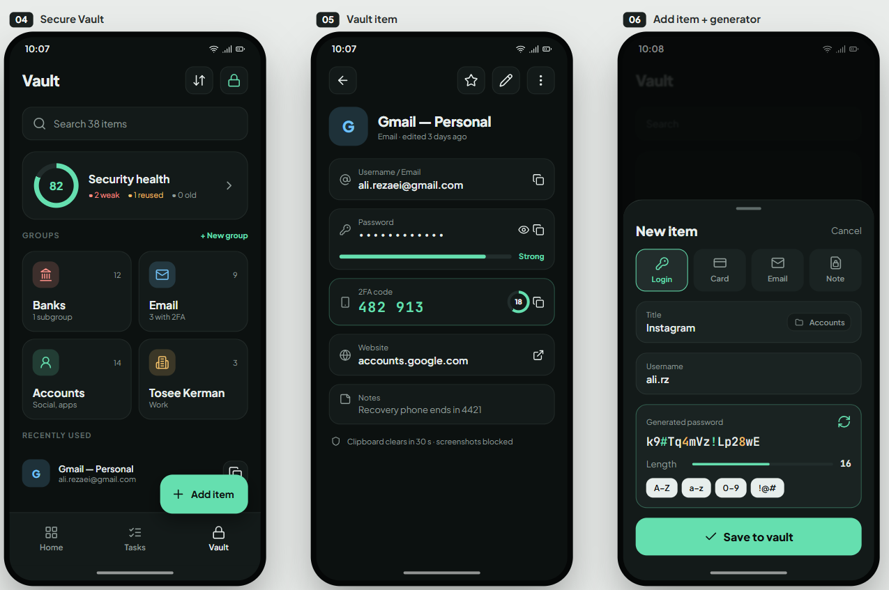

# Stage B component visual review

Date: 2026-10-21. These are actual native Robolectric renders of reusable
components, not redesigned production screens or physical-device screenshots.
All records, counts, dates and credentials are synthetic. Generated candidates
remain masked. The original design images are unchanged.

## Method

`ComponentVisualTest` renders `SharedComponentSpecimens` using native Android
graphics at SDK 28 / mdpi, crops the activity bitmap to the specimen bounds and
writes PNGs. Eleven visual tests produce fifteen captures, including four captures
after scrolling targets into view. Post-scroll captures can be visually identical
when the content already fits. Copies under `evidence/` are verified against the
generated files using SHA-256.

Dark components were reviewed first. Both exact original sheets and all fifteen
native captures were opened with the image viewer. Matching regions below were
compared manually for color, corner geometry, spacing, typography, hierarchy and
independent command targets. This is not an automated pixel-similarity score or an
approved golden-image suite. Different fixture content, viewport sizes and approved
accessibility/functionality changes preclude claiming pixel identity.

## Reference correspondence

Coordinates are approximate original-sheet pixel regions, not Android dp.

| Reference region | Native evidence | Assessment |
| --- | --- | --- |
| Image 1 / 02 workspace cards, around x492-816, y373-507; 00 selection cards | [Dark workspace](evidence/dark-workspace.png) | Flat 16-dp frames, module icon tiles, lavender Tasks and mint Vault. Stacked specimen deliberately demonstrates compact composition; paired-screen layout belongs to Phase 05. No locked Vault counts are shown. |
| Image 1 / 03 task rows, around x932-1255, y294-591 | [Dark workspace](evidence/dark-workspace.png), [280-dp / 200%](evidence/en-workspace-large.png) | Unframed task text, independent completion target and secondary status action. Existing notes/status remain; unsupported recurrence, subtasks and Vault links are absent. |
| Image 1 / 01-03 bottom tabs, around y734-807 within each phone | [Dark workspace](evidence/dark-workspace.png), [large-text post-scroll](evidence/en-workspace-large-scrolled.png) | Three equal labeled presentation targets, selected state, lock affordance; no navigation wiring. Minimum 80-dp content can grow with type. |
| Image 2 / 04 group grid, around x31-356, y360-603 | [400-dp folder pair](evidence/dark-folder-pair.png) | Recognizable, individually colored icon tiles and neutral folder names. Taller frames retain direct-item/subgroup labels and independent 48-dp menus absent from the compact mock. |
| Image 2 / 05 detail fields, around x471-796, y226-610 | [Dark vault fields](evidence/dark-vault.png), [folder/website/notes specimens](evidence/dark-folder-pair.png) | Label/value hierarchy, subtle frame, compact trailing copy/reveal/open targets. Secret values remain fixed-mask by default; URL-shaped secrets cannot expose Open. |
| Image 2 / 06 generator, around x912-1237, y581-729 | [Generator](evidence/dark-generator.png), [masked candidate](evidence/dark-generator-candidate.png) | One framed tool, mint controls and clear apply action. Localized character toggles wrap; the approved 12-128 range/default 24 and explicit Use Password take precedence over literal mock defaults. Generate is secondary and Cancel lower emphasis. |

## Reviewed captures

| Capture | Viewport / state |
| --- | --- |
| [dark-workspace.png](evidence/dark-workspace.png) | 360 x 1100, English, 100%, Tasks/Vault cards, search, task row, chip, bottom navigation. |
| [dark-vault.png](evidence/dark-vault.png) | 360 x 1100, English, 100%, folder, favorite, username/password fields and primary command. |
| [dark-folder-pair.png](evidence/dark-folder-pair.png) | 400 x 1100, English, 100%, two folder cards with >160 dp each, website/notes fields. |
| [dark-generator.png](evidence/dark-generator.png) | 360 x 1100, English, 100%, no candidate; Use Password disabled. |
| [dark-generator-candidate.png](evidence/dark-generator-candidate.png) | 360 x 1100, English, 100%, generated candidate masked, explicit application enabled. |
| [dark-states.png](evidence/dark-states.png) | 360 x 1100, English, 100%, empty/error/loading/disabled/busy states. |
| [light-vault.png](evidence/light-vault.png) | 360 x 1100, English, 100%, approved Light palette. |
| [en-workspace-large.png](evidence/en-workspace-large.png) | 280 x 1100, English, 200%, wrapping cards, task content and labeled tabs. |
| [en-workspace-large-scrolled.png](evidence/en-workspace-large-scrolled.png) | Same fixture after target-scroll checks. |
| [fa-vault-large.png](evidence/fa-vault-large.png) | 320 x 1100, Persian RTL, 200%, wrapping fields and labels; technical value stays LTR. |
| [fa-vault-large-scrolled.png](evidence/fa-vault-large-scrolled.png) | Same fixture after target-scroll checks. |
| [fa-generator-large.png](evidence/fa-generator-large.png) | 320 x 1100, Persian RTL, 200%, character toggles reflow and commands grow. |
| [fa-generator-large-scrolled.png](evidence/fa-generator-large-scrolled.png) | Same fixture after target-scroll checks. |
| [light-fa-vault-large.png](evidence/light-fa-vault-large.png) | 320 x 1100, Persian RTL, 200%, Light palette compatibility. |
| [light-fa-vault-large-scrolled.png](evidence/light-fa-vault-large-scrolled.png) | Same fixture after target-scroll checks. |

## Dark review

## Compatibility review

## Corrections and deviations

- Image review caught black inherited empty/loading text outside a parent Surface.
  Components now set explicit semantic colors; native text-layout color assertions
  prevent recurrence. The final state capture has readable foregrounds.
- Required outlines are brighter than some reference dividers, preserving the
  approved active-control contrast contract. Decorative frame borders remain subtle.
- Focus rings are 2 dp inset rather than offset outside the frame; this avoids
  clipping and neighboring-target overlap in narrow layouts without changing bounds.
- Menus and copy/reveal controls retain 48-dp targets with separation. At large text
  or narrow width, field commands move below values, making frames taller than the
  mock. Text is not shrunk to recover its silhouette.
- Folder menus/direct-count wording and complete note/status presentation are
  preserved despite their omission from reference thumbnails.
- Custom group colors are supplied data, not additional theme colors. Tiles render
  an opaque accent with a derived black/white icon for contrast without modifying
  stored ARGB values.
- A secure-input reveal control is a separate sibling target below the field. This
  permits strict redaction of the entire editable field semantics while keeping
  reveal independently accessible. Revealed secrets remain semantically redacted;
  no read-aloud mechanism is introduced.
- Generator controls retain localized labels and wrap instead of squeezing four
  tiny targets into the reference row. Candidates are hidden until generated,
  masked by default and cannot overwrite a form until explicit Use Password.
- Loading uses a static hourglass rather than a new looping animation. Standard
  Material interaction feedback remains. No Lottie, gradient or new illustration
  was added.
- Unsupported health scores, TOTP, recurrence, subtasks and cross-module links are
  not reproduced. Synthetic local 0-4 strength presentation is not a vault-wide
  security score or a measurement of real credentials.

No clipped tested command labels or overlapping visible command targets were found
in the reviewed captures. This does not certify every combination of caller text,
window size, keyboard, font/display setting or actual TalkBack behavior. Device
accessibility, real IME behavior, drag gestures, reduced-motion setting enforcement
and screenshot-blocking enforcement remain integration/device verification gates.

## Unmodified original authorities

