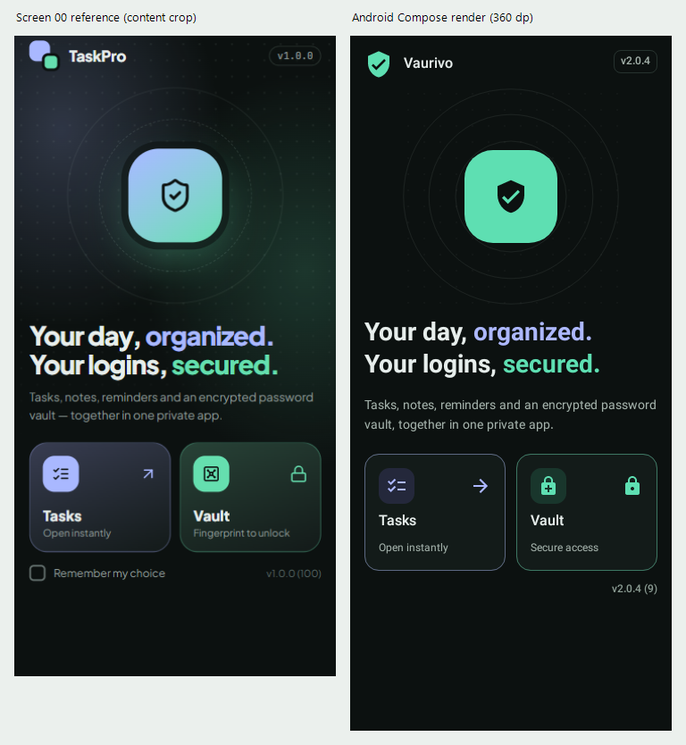

# Phase 05A: Launch / Workspace Chooser

Completed locally, 2026-10-21. Scope: Screen 00 only. No Home dashboard,
Tasks/Vault/editor/Settings redesign, commit, push, release or launcher replacement.

## Preservation and verified baseline

- Branch `main`; HEAD `faadf57eb4911089181bde52fe93f2b90a710266`, unchanged.
- Starting tree: 25 modified tracked files, 90 untracked files; nothing staged.
  Existing work was preserved, not assumed to be committed or published.
- Before source edits, copied and verified all 167 tracked/non-ignored files,
  patches, status and per-file SHA-256 manifests in the private recovery directory:
  `phase05a-20261021/baseline-dc4bebcfb7d4` (private, off-repository).
  Its sibling ZIP SHA-256 is
  `CA00A43E86F91C6FE3EA741E5FEC83675D494F2626556FF719AC3BC1D6B78EA9`.
  Every archive source entry was hash-verified. Git metadata, ignored files,
  runtime databases, local SDK properties and signing material were excluded.
  Source filename/credential-pattern screening passed; not a guarantee of absence.
  This is a private source recovery copy, not a user-data backup. Recover into a
  new directory for comparison, never extract over this dirty checkout.
- The 15 prior Stage B evidence PNGs were verified against freshly regenerated
  native renders before implementation. No reference or prior evidence was edited.
- Independently reran the baseline: **133 tests passed**, debug build and release
  test compilation succeeded, lint **0 errors / 60 warnings**. Historical results
  were not substituted for this run.
- Final hash comparison: **165 starting files byte-identical**, exactly two
  existing files changed (listed below); no starting files missing. No staged
  changes or Git history operations. Whitespace checks passed.

## Exact changed-file list

Paths in this inventory are relative to the repository root, not the much larger
pre-existing Git diff against HEAD.

| File | Purpose |
| --- | --- |
| `app/src/main/java/com/taskpro/app/ui/screens/WorkspaceScreen.kt` | Replace the stacked selector with reference-based Screen 00 using existing tokens, icons and shared WorkspaceCard. |
| `app/src/main/java/com/taskpro/app/ui/navigation/NavGraph.kt` | Hide existing bottom navigation on the chooser only; pass the current Vault lock state. Preserve routes, start destination and saved-tab switching. |
| `app/src/main/res/values/chooser_strings.xml` | Nine localized chooser labels, headline segments and runtime version formats. |
| `app/src/main/res/values-fa/chooser_strings.xml` | Matching Persian resources and indexed placeholders. |
| `app/src/test/java/com/taskpro/app/vault/WorkspaceLaunchTest.kt` | Eight actual MainActivity launch/navigation/authentication/recovery-gate tests with synthetic data. |
| `app/src/test/java/com/taskpro/app/vault/WorkspaceVisualTest.kt` | Ten native rendering/layout cases plus one keyboard interaction case. |
| `docs/phase05a/create-comparison.ps1` | Reproducible local comparison of the original Screen 00 crop and actual Compose capture. |
| `docs/phase05a/REPORT.md` | This report and visual review. |

Also added these **15 image files**, and no others, under
`docs/phase05a/visual-review/`:

```text
dark-en-280-large-scrolled.png
dark-en-280-large.png
dark-en-320.png
dark-en-360.png
dark-en-400.png
dark-en-expanded.png
dark-en-landscape-scrolled.png
dark-en-landscape.png
dark-fa-320-large-scrolled.png
dark-fa-320-large.png
dark-fa-360.png
light-en-360.png
light-fa-320-large-scrolled.png
light-fa-320-large.png
screen00-comparison.png
```

## Chooser behavior and D01

The existing root already implements the required state distinction: after the
mandatory restore-readiness gate, a newly created navigation graph starts at
`workspace`. Navigation's saved state restores an existing stack during activity
recreation. MainActivity, its lifecycle callbacks, readiness gate and
`rememberNavController` ownership were therefore **left unchanged**. No new launch
flag, remembered-module setting, persistent preference or navigation framework.

- Fresh launch: chooser, with only Tasks and Vault as actionable destinations.
- Tasks: existing `home` task-group destination, including its saved child stack
  when explicitly returning through the chooser.
- Vault: existing `vault` destination, retaining first-run master setup, mandatory
  recovery acknowledgement and authentication/session gates. No unlock bypass.
- Recreation/foreground return: retain the current destination; no effect that
  forcibly navigates to the chooser on resume/start.
- Existing Workspaces/Tasks/Vault navigation remains available outside Screen 00.
  Internal `home` continues to mean Tasks groups; a new Home dashboard is not added.
- The chooser exposes no Vault titles, record counts, credentials or other content.
  Its lock indication is presentation state only, never authorization.
- No Remember my choice checkbox, inactive control or fingerprint availability claim.

## Reference fidelity and actual captures

Inspected the original image, all eight Phase 04A specifications, the actual
Stage A tokens/theme and Stage B components/reports. The current Phase 05A D01
overrides the older Phase 04A first-run/remembered-choice recommendation.



This is a comparison of the supplied rightmost phone and an **actual Android
Compose rendering of the production WorkspaceScreen**, not generated art or a
mock HTML replacement. Captures use Robolectric SDK 28 native Android graphics,
real fonts/resources/layout and the Activity decor view drawn to Android Bitmap.
They are not physical-device/emulator captures or evidence of OS chrome behavior.
Only synthetic UI/data were used. The comparison crops the reference to
`x=1355, y=88, width=357, height=711`, scales uniformly to 360-pixel width and places
the unchanged 360-dp native capture beside it. Original aspect ratios are retained;
the reference's status bar/bezel are excluded rather than drawn into the app.

### Visual findings

| Reference region | Implemented result and reviewed differences |
| --- | --- |
| Brand and compact version header | Same top brand/version hierarchy; Vaurivo and actual BuildConfig 2.0.4 / code 9 replace obsolete mock branding/version. Existing VerifiedUser asset replaces neither launcher artwork nor a final logo. |
| Centered symbolic region | Centered 104-dp mint tile, existing security icon, three low-opacity rings and faint dot pattern in a reserved region. Static decoration only; no new gradient, glow, illustration, animation library or simulated security status. Symbol remains non-directional in Persian. |
| Introductory text | Two-line headline, lavender organized and mint secured emphasis, followed by short supporting text. Existing Vazirmatn and approved 28/36 display and 14/22 body roles preserve readable hierarchy. Font metrics and supporting line spacing differ modestly from the source; no viewport-based font shrinking. |
| Module choices | Shared WorkspaceCard, paired at normal 360/400-dp widths, lavender/mint outlines and existing module icons. Deliberately retains Stage B neutral surfaces/muted icon tiles instead of inventing new gradient cards. Entire card is one large, labeled action. |
| Lower information | Real compact version/build. Remember choice intentionally omitted under D01. Vault subtitle says Secure access, not Fingerprint to unlock, because app/device biometric configuration cannot be assumed. |
| Overall structure | Flat approved charcoal canvas, restrained central emphasis, left/start-aligned copy, paired module cards and no bottom tabs on Screen 00. No independent dashboard or alternative landing composition. |

All 14 native captures and the combined comparison were visually inspected.
Normal dark/light EN/FA layouts are readable; Persian mirrors text/card order and
navigation arrows while leaving the shield and technical version strings intact.
Card heights match within a row. Large text and narrow widths stack cards rather
than truncate; short landscape reduces the symbol region and allows scrolling.
Initial and scrolled evidence demonstrate both destinations remain reachable.
At 320 dp or font scale above 1.3 the conservative stacked layout intentionally
differs from the reference pair. Expanded layouts cap content width at 560 dp.
Short/large-text captures are viewports into scrollable content, not clipped fixed
forms; the content continues beyond their initial frame.

The selector now owns a flat themed canvas to match Screen 00. Existing stored
SYSTEM/LIGHT/DARK and PLAIN/GRADIENT/AURORA values/defaults and all other screen
background implementations remain byte-identical; no preference is rewritten.

## Executed verification

Environment: Windows, JDK 21.0.8, installed platform 35/build-tools 36.0.0 through
the existing ignored `.gradle/local-sdk.init.gradle`. No toolchain, dependency,
workflow or build configuration changed in this phase. CI JDK 17 parity was not run.

Focused Workspace and existing Vault-screen runs were followed by this final run:

```powershell
$env:JAVA_HOME='C:\Program Files\Android\openjdk\jdk-21.0.8'
$env:ANDROID_HOME='C:\Program Files (x86)\Android\android-sdk'
.\gradlew.bat -I .gradle/local-sdk.init.gradle :app:testDebugUnitTest --rerun :app:lintDebug :app:assembleDebug :app:compileReleaseUnitTestKotlin --console=plain
```

| Check | Result |
| --- | --- |
| Full debug unit suite | **152 passed, 19 suites, 0 failures/errors/skips**. All 133 starting tests retained unchanged plus 19 new tests. |
| WorkspaceLaunchTest | **8 passed**: fresh chooser/actions/version; saved-state activity recreation preserves group/task IDs/notes; background/foreground return; new Activity launch returns to chooser without erasing tasks; explicit chooser re-selection restores task child stack; first-use Vault setup without data creation; locked Vault stays authenticated-gated across recreation; failed startup recovery blocks chooser until valid journal replay succeeds. |
| Existing WorkspaceNavigationTest | **1 passed unchanged**: Tasks/Vault switching, task data, Vault session and secure-window lifecycle. |
| WorkspaceVisualTest native cases | **10 passed**, 14 PNGs. Dark EN 360x778, 400x850, 320x640, 280x480 at 200%, 600x360 landscape, 840x600 expanded; dark FA 360x778 and 320x640 at 200%; light EN 360x778 and light FA 320x640 at 200%. Each verifies two real callback destinations, card geometry/order, minimum 48-dp action bounds, headings/roles, actual paragraph glyph fit and reachable actions after scrolling. |
| Keyboard case | **1 passed** with Robolectric legacy graphics: explicit focus, Enter invokes Tasks exactly once, Tab moves to Vault and Enter invokes Vault exactly once. Native graphics still produce an invalid-focus-rectangle harness error; screenshots/layout checks continue to use native mode. No production focus workaround or assertion removal. |
| Existing security/compatibility regressions | All unchanged external-intent, first-run/master/recovery, device-unlock, session/integration, encrypted/legacy backup, migration/reminder, branding and theme/preferences tests pass in full suite. Not a claim of exhaustive physical workflow coverage. |
| Lint | **0 errors / 60 warnings**. Compared before/after XML by ID, severity, message and file: identical warning signatures. |
| Debug APK | **BUILD SUCCESSFUL**. `app/build/outputs/apk/debug/app-debug.apk`; not published. |
| Release test compilation | **Succeeded**. Release tests/signing/release APK were not executed or produced. |
| Scope review | All changed source/resources/tests reviewed against the private starting baseline; 165 other starting files unchanged, none deleted; Git index/HEAD unchanged; whitespace checks passed. |

Development checks caught a trailing-lambda source compatibility break, test-only
Room singleton leakage between Robolectric SQLite resets, and a missing native
RTL symbol. Fixed callback parameter ordering, isolated/closed synthetic test DBs
and kept the decorative symbol LTR. Existing tests and security assertions were
not weakened. Keyboard testing was explicitly separated from the native renderer's
focus limitation rather than presented as a native-renderer pass.

Inherited warnings include dependency/tooling updates, unused resources, locale,
launcher and SDK advisories. Read-only SDK package.xml marshalling and existing
Undo-icon deprecation also remain. Final debug APK SHA-256:
`24BCCBC69DE887685354ADB147D252FD7A0C8C58C0B301AB5C4BC1933CD5ECBA`.
`aapt dump badging` confirms `com.taskpro.app`, Vaurivo, version 2.0.4/code 9,
minimum SDK 24 and target 35. Baseline/final JUnit and lint XML are preserved
privately beside the source snapshot.

## Compatibility verification

No application ID/namespace/class/route rename; no Room schema/migration/database
change; no DataStore key, enum or default changes; no encryption parameters, AAD,
Keystore alias or format changes; no backup/reminder/signing identity changes.
All corresponding files, MainActivity and every Tasks/Vault/Settings source file
except WorkspaceScreen are byte-identical to the starting snapshot. Stage B
components and Stage A theme files are also unchanged. No user records are read
or rewritten by the chooser; new tests use synthetic local data only.

## Reproduce visual evidence

1. Run `:app:testDebugUnitTest --tests 'com.taskpro.app.vault.WorkspaceVisualTest'`
   with the toolchain/init-script environment above. PNGs are written to
   `app/build/reports/workspace/` by the real production composable.
2. Run `docs/phase05a/create-comparison.ps1` from PowerShell with System.Drawing.
   It reads the original repository reference and freshly generated dark EN PNG.
3. On a device/emulator, install an update using the original compatible signing
   identity without uninstalling or clearing data. Capture the chooser on a new
   launch; navigate to Tasks and rotate/background/return; enter Vault and verify
   its existing setup/lock gate. Use synthetic data for all screenshots.

## Remaining limits and Phase 05B readiness

- Actual hardware rotation, Recents/task-manager gestures, process kill with OS
  task restoration, foldables, system cutout/gesture/three-button bar insets,
  real TalkBack traversal and scale-zero animation behavior are not device-tested.
  Activity recreation and foreground return were executed in Robolectric, not
  relabeled as physical-device tests. Standard Compose animation duration scaling
  and shared Material ripple/hover/focus remain; there is no custom motion loop.
- No new biometric/device PIN behavior was introduced. Real Keystore/biometric
  hardware validation, original installed signing continuity and in-place release
  update remain separate device/release gates.
- Native and legacy Android renderers cover different checks as described above.
  These captures are meaningful production-composable evidence, not a certification
  of all Android versions, accessibility services or OS lifecycle conditions.
- Existing dirty/untracked work is still uncommitted. A GitHub APK cannot be assumed
  to contain this implementation. No CI dispatch, remote publication or release.
- **Ready for owner review and separately authorized Phase 05B**, with the above
  device QA limitations. No Home dashboard or other phase started automatically.
