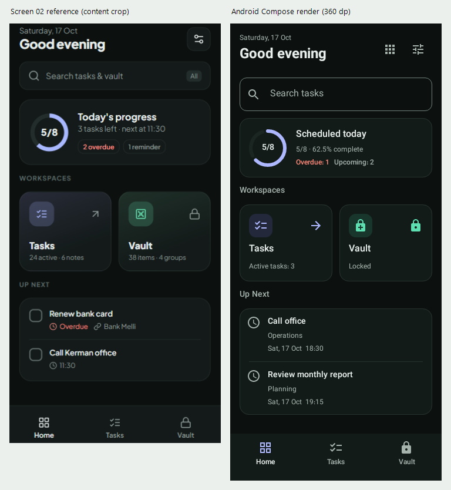

# Phase 05B: Home Dashboard

Implemented and verified locally, 2026-10-21. Scope is Screen 02 only, using the
second phone in the original reference. No Tasks/Vault redesign, schema change,
commit, push, release publication or Phase 05C implementation.

## Preservation and Baseline

- Branch `main`, unchanged HEAD `faadf57eb4911089181bde52fe93f2b90a710266`.
  Starting tree contained 25 modified tracked and 112 untracked files; none staged.
- Before source edits, verified a private recovery copy of all **189** tracked and
  non-ignored files, per-file SHA-256 manifests, status/HEAD and existing patches:
  `phase05b-20261021/baseline-04cf257f06dd` (private, off-repository).
  Its sibling ZIP SHA-256 is
  `ABCDAEFBAA87434B6108D117CA0BB7E0F10DD560E14D48EEEDC7AF03F8443DCE`.
  File copies and archived entries were hash-verified. Git metadata, ignored
  local state, runtime databases, SDK properties and signing material were excluded.
  Filename/credential-signature screening passed, not a guarantee of absence of
  arbitrary secrets. This is a private source snapshot, not a user-data backup.
  Recovery should extract into a new directory, never overwrite a dirty checkout.
- Independently reran the starting baseline: **152 tests passed**, debug build and
  release-test compilation succeeded; lint **0 errors / 60 warnings**.
- Final scope comparison: **182 starting files byte-identical**, seven existing
  files changed as listed below; none deleted. The chooser source/composition,
  prior evidence, existing Tasks/Vault/Settings layouts and theme/shared-component
  implementations remain byte-identical. No history/index changes.

## Implementation

Home now provides localized Gregorian date/time-of-day greeting, Settings and an
explicit chooser shortcut, Tasks-only search, scheduled-today progress with real
fraction/percentage, safe Tasks/Vault workspace cards and real Up Next tasks.
Dark/Light palettes, Vazirmatn, shared SearchField, WorkspaceCard, SectionHeader,
IconAction, state controls and BottomNavigationBar are reused without modifying
their existing implementations. No new dependency or framework.

Production data comes only from the existing Room/TaskRepository path. Synthetic
sample tasks exist only under tests, never in production defaults or startup code.
Home does not complete tasks or alter manual order: upcoming/search rows open
the existing owning group or status-list flow, where existing actions remain.

### Progress Definition (D03)

- Day interval is **[local start of day, next local start of day)** using the
  current time zone. Calendar-day addition handles 23/25-hour DST days; no fixed
  24-hour assumption.
- Denominator: every task with dueAt inside that interval, across existing groups,
  including Pending, Completed and Snoozed. Undated tasks are excluded.
- Numerator: only tasks in that set whose current status is COMPLETED. This is
  not completion history and is never labeled tasks completed today.
- Display includes the exact completed/scheduled counts and a localized percentage
  rounded to at most one decimal place. The ring represents the actual fraction.
- Empty day: no 0/0 or invented 0% success indicator. Loading/error/retry are
  distinct from a successfully empty dataset.
- Active tasks counts all non-completed tasks, including undated and snoozed.
  Overdue means non-completed with dueAt strictly before now, across all dates.
  Upcoming count means non-completed with dueAt strictly after now; it is not a
  guarantee that Android notification/alarm permissions are granted.

One read-only observable JOIN of tasks/items reuses TaskWithItemName and invalidates
on task insert/edit/status/delete and group rename/deletion. DashboardViewModel
combines it with a one-second wall-clock/time-zone Flow while observed. Clock and
time-zone changes, due times passing and midnight are therefore reflected within
approximately one second while Home is visible. Re-entry samples the current clock
immediately; unsubscribing stops the clock and resets stale dashboard state.
No broadcast receiver, preference, schema or stored timestamp is added/rewritten.
The query reads all tasks to derive cross-group totals; exceptionally large task
datasets may warrant separately measured SQL aggregation later.

### Up Next and Search

- Up Next filters to dueAt > now and status != COMPLETED, sorts by dueAt ascending
  then stable task ID, and displays the first **three**. No overdue/undated/completed
  task is falsely shown as a future actionable item.
- Rows show title, owning group and localized Gregorian due date/time. Pending rows
  open existing item detail; Snoozed rows open that group's Snoozed list. Search
  results similarly route completed tasks to the existing Completed list.
- No query projection is written back to Task.position; no reminder scheduling
  method changes or new writes in the dashboard.
- Home reuses SearchViewModel and the unchanged DAO title/notes LIKE search, with
  its 200-ms debounce and trimmed query. Loading/failure/retry state was added while
  preserving the existing results API for the original search screen. Empty query
  returns to the dashboard; results are labeled as Tasks, never federated Vault data.

### Navigation and Insets

- New `dashboard` route serves Home; existing `home` still serves Tasks groups.
  All old routes/arguments remain. The existing workspace route remains the root
  start destination after the mandatory restore-readiness gate.
- Chooser Tasks/Vault callbacks and composition are unchanged. Home is reachable
  through bottom navigation after entering either workspace. No remembered module.
- One shared Home/Tasks/Vault bar replaces the old bar; it is hidden on the chooser.
  Task groups, status lists and task search select Tasks; Vault remains selected
  for its protected local states. Settings retains its invoking tab's selection.
- Existing singleTop/saveState/restoreState switching is retained. Explicit chooser
  access moves to Home's Workspaces icon, in addition to existing Vault affordances.
  The launch regression test selectors were updated for this approved tab change;
  its data, lifecycle and startup-recovery assertions were retained.
- The bar owns bottom system padding; NavHost consumes its padding once. Home owns
  remaining safe drawing insets and scrolls when height or text size requires it.

## Exact Changed Files

Paths are repository-relative. This phase's changes are measured against the
private starting snapshot, not the extensive pre-existing Git diff against HEAD.

| File | Change |
| --- | --- |
| `app/src/main/java/com/taskpro/app/data/TaskDao.kt` | One read-only observable tasks/items JOIN; no schema changes. |
| `app/src/main/java/com/taskpro/app/data/TaskRepository.kt` | Expose that Flow without changing write/reminder methods. |
| `app/src/main/java/com/taskpro/app/ui/AppViewModelProvider.kt` | Register DashboardViewModel in the existing factory. |
| `app/src/main/java/com/taskpro/app/ui/navigation/Screen.kt` | Add dashboard route; preserve existing route strings. |
| `app/src/main/java/com/taskpro/app/ui/navigation/NavGraph.kt` | Home route, shared bar, tab ancestry, existing task/status routing, inset consumption and lock-boolean projection. |
| `app/src/main/java/com/taskpro/app/ui/screens/search/SearchViewModel.kt` | Reuse existing search with explicit loading/error/retry state; keep results API. |
| `app/src/test/java/com/taskpro/app/vault/WorkspaceLaunchTest.kt` | Update three navigation selectors for Home/chooser access; retain all eight tests and safety assertions. |
| `app/src/main/java/com/taskpro/app/ui/screens/dashboard/DashboardState.kt` | Local-day bounds, deterministic pure projections, clock and presentation models. |
| `app/src/main/java/com/taskpro/app/ui/screens/dashboard/DashboardViewModel.kt` | Read-only Flow combination, retry and visibility-scoped lifetime. |
| `app/src/main/java/com/taskpro/app/ui/screens/dashboard/DashboardScreen.kt` | Production Home route/UI, localized header, search, summary, workspace and upcoming composition. |
| `app/src/main/res/values/dashboard_strings.xml` | 23 English labels/format strings. |
| `app/src/main/res/values-fa/dashboard_strings.xml` | Matching Persian resources/placeholders. |
| `app/src/test/java/com/taskpro/app/dashboard/DashboardSummaryTest.kt` | Nine pure metric/boundary/order tests. |
| `app/src/test/java/com/taskpro/app/dashboard/DashboardDataTest.kt` | Seven Room/Flow/ViewModel/search/session tests with synthetic data. |
| `app/src/test/java/com/taskpro/app/dashboard/DashboardNavigationTest.kt` | Five real MainActivity integration/navigation/privacy tests. |
| `app/src/test/java/com/taskpro/app/dashboard/DashboardVisualTest.kt` | Six native capture/layout tests, empty/loading/error states and one keyboard test. |
| `docs/phase05b/create-comparison.ps1` | Reproducible original Screen 02 / native render comparison. |
| `docs/phase05b/REPORT.md` | This implementation and visual review. |

Also added exactly the following 13 PNGs under `docs/phase05b/visual-review/`:

```text
home-dark-en.png
home-dark-en-scrolled.png
home-dark-fa.png
home-dark-fa-scrolled.png
home-light-en.png
home-light-en-scrolled.png
home-en-large.png
home-en-large-scrolled.png
home-fa-large.png
home-fa-large-scrolled.png
home-landscape.png
home-landscape-scrolled.png
home-reference-comparison.png
```

## Actual Visual Evidence

- [Dark English, 360 x 778](visual-review/home-dark-en.png)
- [Dark Persian, 360 x 778](visual-review/home-dark-fa.png)
- [Light English, 360 x 778](visual-review/home-light-en.png)
- [Narrow English 280 x 640, 200% text](visual-review/home-en-large.png)
- [Same narrow case, scrolled](visual-review/home-en-large-scrolled.png)
- [Persian 320 x 640, 200% text](visual-review/home-fa-large.png)
- [Persian large case, scrolled](visual-review/home-fa-large-scrolled.png)
- [Landscape 640 x 360](visual-review/home-landscape.png)
- [Landscape scrolled](visual-review/home-landscape-scrolled.png)
- [Reference side-by-side](visual-review/home-reference-comparison.png)



These are **actual Android Compose-rendered screenshots** using Robolectric SDK 28
native graphics, real resources/fonts and Android Canvas/Bitmap decor-view capture.
They render the production DashboardScreen plus the same shared bottom bar/inset
shell, with an injected synthetic Task snapshot and fixed clock. They are not
AI-generated art, Stage B component specimens or emulator/device APK captures.
Real Room/MainActivity behavior is tested separately by integration tests.

Synthetic snapshot: eight tasks scheduled on 17 October 2026 in UTC, five currently
completed, one overdue and two future tasks in two groups. Hence 5/8, 62.5%, three
active tasks and two upcoming are real calculations from the fixture, not production
demo values. Gregorian Persian date/digits and mixed English task/group text are
intentional bilingual test content. No personal credentials or real Vault data.

Comparison script crops only reference Screen 02 at x=475, y=88, width=358,
height=710, scales approximately uniformly to 360 x 714, and places the unchanged
360 x 778 native capture beside it. It excludes reference bezel/status chrome;
different app-content viewport heights remain visible, not stretched to conceal them.

### Fidelity Assessment

| Region | Matching composition and justified differences |
| --- | --- |
| Overall hierarchy | Same date/greeting/settings, search, one ring summary, Workspaces pair, Up Next list and bottom navigation. No independent dashboard design or new hero/illustration. |
| Header | Existing 24/32 greeting and 12/18 date typography. Added a working Workspaces icon to preserve explicit chooser access now that the bottom tab is Home. No invented account name. |
| Search | Reuses approved 56-dp-minimum SearchField and clear/focus behavior. Tasks-only wording and no All/Vault scope chip are required security/product differences. Interactive outline is stronger than the mock's faint border. |
| Progress | Same left ring/right explanatory column on normal phones; true fraction/percentage and scheduled-today heading replace ambiguous progress copy. One redundant remaining-count line was removed and 12-dp spacing used after side-by-side review to improve density. |
| Workspace cards | Same paired lavender Tasks/mint Vault hierarchy and shared 128-dp-minimum cards. Flat token surfaces, muted icon tiles and existing icons differ from mock lighting. Actual active-task summary replaces unsupported notes counts; generic Vault status replaces confidential counts. |
| Up Next | Same framed list/dividers and compact title/metadata hierarchy. Future-only rows replace the reference's overdue first item under the approved filter. Schedule icons, not nonfunctional completion checkboxes; tapping opens existing task actions. Group plus full due date/time add readable metadata height. |
| Bottom bar | Real shared Home/Tasks/Vault bar, selected state and 48-dp-minimum targets. Approved 80-dp height/readable labels can differ from the source's smaller apparent chrome. No duplicate bars. |
| Colors/type | Exact existing semantic palettes/Vazirmatn, not sampled substitute branding. Flat charcoal surfaces and accessible text/outline contrast; corresponding Light palette preserved. No gradient decoration or new assets. |
| Responsive/RTL | Normal EN/FA pair and ring layout; Persian mirrors layout/icons while English task text retains content direction. At <340 dp or >1.3 font scale, cards and ring/details stack and the screen scrolls. Large/landscape scrolled evidence shows reachable content without font shrinking. |

The composition closely follows Screen 02, but it is not pixel-identical. Approved
control sizes, readable typography, full metadata and the extra chooser affordance
make some spacing/heights different. Reference and native captures have different
app-content heights; initial frames need not expose identical amounts of the list.
All final captures and the comparison were visually inspected, including ring,
fraction, labels, lower list and persistent navigation in English and Persian.

## Executed Verification

Windows, JDK 21.0.8, installed platform 35/build-tools 36.0.0 through the existing
ignored local SDK init script. No toolchain/dependency/workflow changes. Final run:

```powershell
$env:JAVA_HOME='C:\Program Files\Android\openjdk\jdk-21.0.8'
$env:ANDROID_HOME='C:\Program Files (x86)\Android\android-sdk'
.\gradlew.bat -I .gradle/local-sdk.init.gradle :app:testDebugUnitTest --rerun :app:lintDebug :app:assembleDebug :app:compileReleaseUnitTestKotlin --console=plain
```

| Check | Executed result |
| --- | --- |
| Full suite | **181 passed, 23 suites, 0 failures/errors/skips**: 152 retained baseline tests plus 29 dashboard tests. |
| Pure summary tests | **9 passed**: empty denominator, statuses, undated tasks, inclusive/exclusive day boundaries, midnight, zone changes, 23/25-hour DST days, future filtering, stable tie/order and unchanged positions. |
| Data/ViewModel tests | **7 passed**: actual Room insert/edit/status/delete/group rename invalidation, cascading group deletion, read-only positions, title/notes search, injected midnight/time-zone refresh, failure/retry, debounce/clear and Vault away-deadline protection despite touch events. |
| MainActivity integration | **5 passed**: Tasks workspace card/group access; Settings Back/recreation; chooser reopening; Vault setup/locked routing; no unlocked Vault title/category/username leakage in Home/search; notes search; future Snoozed route and unchanged status/position; tab ancestry. |
| Visual/accessibility checks | **8 passed**: six native EN/FA/Light/narrow/large/landscape configurations produce twelve PNGs; real action sizes, selected tab, title/group/date glyph fit and scroll/callback checks; empty/loading/error/retry with no 0/0; keyboard focus/Enter for Settings. Keyboard case uses legacy graphics due the known Robolectric native-focus limitation. |
| Existing regressions | All retained backup, migration, reminders, crypto, master/recovery, device-unlock, external-intent, Vault UI/session, theme/preferences, shared-component and chooser tests passed. Selector-only updates in one launch test file reflect approved navigation, not weakened assertions. |
| Lint | **0 errors / 60 existing warnings**. Compared XML by ID, severity, message and file: no warning-signature changes. |
| Debug build | **Succeeded**; local `app/build/outputs/apk/debug/app-debug.apk`, not published. |
| Release-test compilation | **Succeeded**; no release test execution, signed release build or publication. |
| Scope review | Starting-file hashes, complete changed-file review, Git index/HEAD and whitespace checks. No missing starting files or unrelated source changes. |

Development failures were test-fixture issues (non-void JUnit setup, incorrect Vault
fixture constructor, selecting cards as tabs, debounce on a paused Robolectric
Looper, and a boundary fixture with dueAt equal to now). Corrected fixtures and
explicit simulated timer advancement; production day/search semantics and safety
assertions were not weakened. Final visual review also tightened density and kept
the date/greeting available during task loading/error states.

Inherited read-only SDK package.xml marshalling, dependency/tooling/launcher/locale
lint advisories and existing Undo-icon deprecation remain. JDK 17 CI parity,
physical-device behavior and release signing were not verified remotely. Baseline
and final JUnit/lint XML are preserved privately beside the source recovery copy.

Final `aapt dump badging` confirms `com.taskpro.app`, Vaurivo, version 2.0.4/code 9,
minimum SDK 24 and target SDK 35. Debug APK SHA-256:
`F025F16805AD19C360BE16838CE4CC8DE51BA6E52A67A5C66CB134E6BA115F45`.

## Security and Compatibility

Home accepts Task-only presentation state plus a Vault lock boolean. NavGraph maps
the existing Vault state to that boolean before collecting it; no decrypted record
models, counts, folders or search indexes are handed to Home. No biometric call,
master/recovery behavior, clipboard policy or Vault session timing changes.
Existing Vault disposal still marks it invisible; Home touches cannot reset the
absolute away deadline (covered with synthetic clock/authentication tests).

No applicationId/namespace, database/schema/migration, persisted settings keys or
values, encryption/AAD/Keystore alias, backup protocol, reminder identity/scheduling,
signing configuration or existing ID changes. `com.taskpro.app` and version
2.0.4/code 9 remain. Task repository write/reminder methods are byte-equivalent in
the scoped diff. All non-dashboard Tasks/Vault/Settings layouts and the chooser
remain unchanged. New Home uses a flat semantic canvas without rewriting existing
background-style preferences; existing screens keep their selected backgrounds.

## Reproduction and Remaining Limits

Run `:app:testDebugUnitTest --tests 'com.taskpro.app.dashboard.DashboardVisualTest'`
with the environment above to regenerate production-composable PNGs in
`app/build/reports/dashboard/`, then run `docs/phase05b/create-comparison.ps1`.
Copy the twelve `home-*.png` captures from that build report directory to
`docs/phase05b/visual-review/` to refresh the individual evidence files as well.
Use synthetic data only for any device screenshots. Install only with the existing
compatible signing identity; do not uninstall/clear user data to bypass update errors.

Physical TalkBack, real keyboard/IME, system bars/cutouts, actual rotation/Recents/
process death, biometric hardware, foldables and reduced-motion behavior remain
device QA, not certified by Robolectric screenshots. One-second time sampling is
intentional rather than instantaneous broadcasts. Very large dataset performance
has not been benchmarked. A prior Phase 05A Persian capture discrepancy was not
fixed or hidden in this phase because its chooser composition was frozen.

**Ready for owner review and separately authorized Phase 05C**, subject to these
device/release limits. No Tasks/Vault redesign, commit, push or publication follows
automatically from this report.
