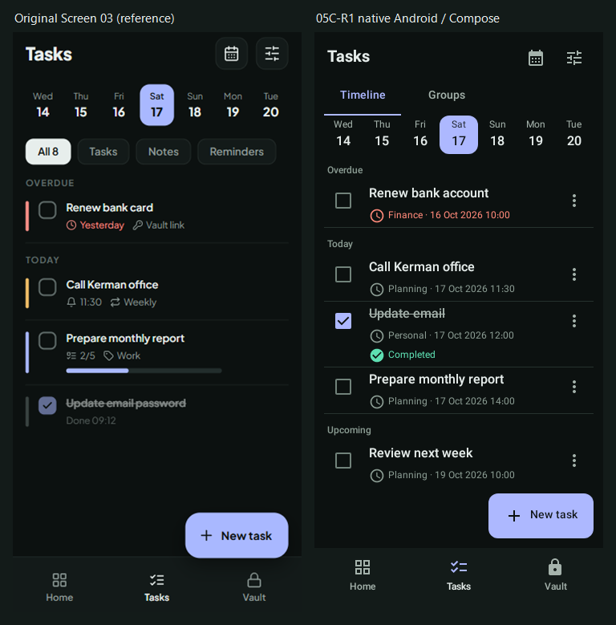

# Phase 05C-R1 Visual QA

Date: 2026-10-21. final result: passed

This means no actionable P0/P1/P2 finding remains within the approved R1 scope; owner visual approval and physical-device QA are still outstanding. It does not claim an exact clone of the reference.

## Evidence

- Source visual truth: `docs/phase04a/references/01-launch-unlock-home-tasks.png`, Screen 03. The original and the previous Phase 05C captures/comparison were inspected.
- Implementation: `timeline-dark-en.png`, `timeline-dark-fa.png`, `timeline-filters-en.png`, `timeline-filters-fa.png`, and the additional states below. These are native Android/Compose renders of production components, via Robolectric SDK 28 native graphics; not a browser, emulator or physical device.
- Full-view combined input: [timeline-reference-comparison.png](timeline-reference-comparison.png). Both images were opened together before judging fidelity.
- Normalization: app-owned reference crop `(916,88,356,715)` scaled by width to 360x723. Actual `timeline-reference-sized.png` rendered at 360x723, density 1. Labels/margins produce a 768x779 comparison. No fabricated phone/status chrome or UI pixel retouching.
- Default renders: 360x778dp at mdpi, 1x text, EN/LTR and FA/RTL, All dates/All statuses, synthetic fixtures at 2026-10-17 10:00 UTC. Reference content is illustrative and differs from the fixtures; compare hierarchy/layout, not task counts.
- Focused checks used the full-resolution standalone Timeline, filter-panel, active-state and 200% captures. Their controls/text are readable at these sizes, so no enlarged or retouched detail crop was needed.

## Findings And Required Fidelity Surfaces

| Surface | Observed result / classification |
| --- | --- |
| Fonts and typography | Existing Vazirmatn family/weights and theme sizes retained, zero tracking; tight title/metadata hierarchy with natural wrapping. Not an exact match to the mock's font rasterization. Preserved design-system constraint, not a new R1 mismatch. |
| Spacing and layout | Compact 48dp-min tabs directly below header, then 48dp-min Gregorian days. No default All dates/Undated/Status row. Less section/row padding; body/checkbox/menu targets remain at least 48dp. Large FA labels can wrap; they do not push into adjacent controls. |
| Colors and tokens | Existing near-black/green-neutral canvas, muted secondary metadata, lavender Tasks accent and semantic status colors retained. Selected date/selected tab remain distinct in dark and light renders. No new decorative surfaces. |
| Images and icons | Original native Material icons retained; no raster mockup substituted for the UI. This screen has no photographic or illustrative asset to regenerate. Checkbox shape, icon family and unframed header tools differ from the mock as pre-existing component choices. |
| Copy and content | Real task title/group/full-date/status information preserved. Approved Timeline/Groups navigation replaces the mock's task-type-chip composition. Mock-only recurrence/progress/Vault links are intentionally not added. All dates/Undated/status/notes/due/Search are available in the panel. |
| Responsive behavior | 320x640 at 200% text tested in both languages; date strip scrolls, task text wraps, full task list scrolls. 640x360 landscape keeps persistent actions/navigation; scrolling reveals rows beyond the compact header. No touch-target reduction used to force a fit. |
| RTL/LTR | Persian layout mirrors logically, including checkbox/menu placement and FAB alignment. Gregorian dates are localized without changing calendar semantics. Actual Persian sheet-window resources are verified, not English resources in a mirrored screenshot. |
| State and accessibility | Nondefault filters show an accent dot, readable wrapping scope/status caption and localized accessibility state. Reset returns default scope. Independent task body/checkbox/menu and selected tab semantics verified. Native paragraph height/width and target-size checks pass; RTL combining-mark ink bounds still require pixel review because native intrinsic metrics are not reliable for those marks. |

No P0/P1/P2 layout issue was found in the final combined comparison within the limited requested scope. Existing completed-status detail and full date/group metadata intentionally take more room than the illustrative mock. Removing them would change the approved product behavior/content.

## Capture Validation History

1. First focused run: English/other renders and interaction checks passed; Persian sheet capture failed because its activity context remained English even though the parent composition was Persian. This was a test-harness fault, not an application translation change. Native dialog captures now configure the actual Android locale and composite real dialog bounds relative to the activity.
2. Follow-up check: set the native system font scale for the large-text dialog case (not only the parent composition). Verified the final 200% sheet and its scroll access. Added target/text layout checks to the panel captures.
3. Final full run: 237 tests passed; native captures regenerated, copied unchanged and inspected. No application-code change was made to disguise a reference difference.

## Gallery

| State | Image |
| --- | --- |
| Refined Timeline / Dark English | [timeline-dark-en.png](timeline-dark-en.png) |
| Refined Timeline / Dark Persian | [timeline-dark-fa.png](timeline-dark-fa.png) |
| Open panel / English | [timeline-filters-en.png](timeline-filters-en.png) |
| Open panel / Persian | [timeline-filters-fa.png](timeline-filters-fa.png) |
| Active scope / English | [timeline-filters-en-active.png](timeline-filters-en-active.png) |
| Active scope / Persian | [timeline-filters-fa-active.png](timeline-filters-fa-active.png) |
| Open panel / 200% text | [timeline-filters-large.png](timeline-filters-large.png) |
| Timeline / 320dp / 200% English | [timeline-en-large.png](timeline-en-large.png), [scrolled](timeline-en-large-scrolled.png) |
| Timeline / 320dp / 200% Persian | [timeline-fa-large.png](timeline-fa-large.png), [scrolled](timeline-fa-large-scrolled.png) |
| Landscape | [timeline-landscape.png](timeline-landscape.png), [scrolled](timeline-landscape-scrolled.png) |
| Light theme | [timeline-light-en.png](timeline-light-en.png) |
| Groups / compact selected tab | [groups-dark-en.png](groups-dark-en.png), [Persian](groups-dark-fa.png), [200% Persian](groups-fa-large.png) |

PNG provenance and hashes: [artifacts.csv](artifacts.csv). Twenty-six direct native captures plus one reference comparison. Scrolled frames verify access to content beyond the first viewport; `*-active` frames show the sheet closed after selecting Has due date. Dialog scrim/background are drawn by the actual Material sheet, not painted manually.

## Follow-up / Stop

- Owner reviews screenshots before approving any next phase.
- Physical Android device/TalkBack/Android 12/OEM behavior remains unverified. No real-device capture is claimed.
- No Vault work, new Tasks features, navigation/schema changes, commit, push or publication.
