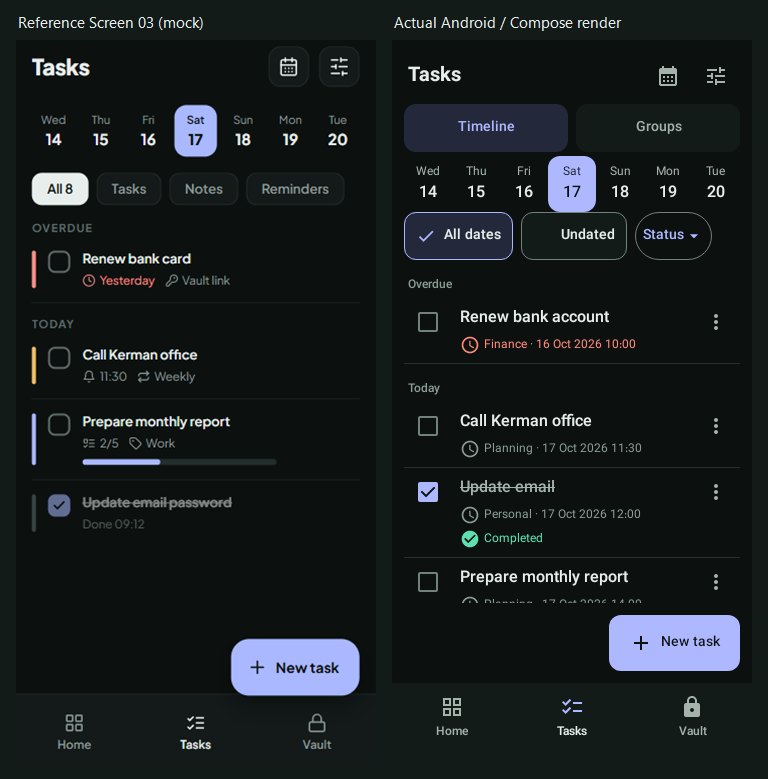

# Phase 05C - Native Visual Review

## Provenance

The twenty individual images below are actual Android/Jetpack Compose renders
using Robolectric native graphics, SDK 28, the production TimelineScreen or
GroupsScreen, TaskProTheme/Vazirmatn, and the same shared bottom-navigation shell.
They are not AI images, browser mockups, component-only previews, or screenshots
from an installed phone/emulator. ADB reported no connected devices; the configured
SDK has no emulator executable. Physical-device verification remains outstanding.

`TasksVisualTest` supplies six synthetic tasks in three groups and a fixed
2026-10-17 10:00 UTC clock. Group counts are computed from that same synthetic
dataset. No personal credentials, decrypted Vault records or real task data are
used. Native output PNGs are copied byte-for-byte from `app/build/reports/tasks/`;
source/destination SHA-256 equality was checked for all twenty files.

Images exclude simulated phone frames, status bars and gesture indicators.
`-scrolled` captures demonstrate that later tasks/groups remain reachable, not a
second alternative design. `TasksNavigationTest` separately exercises real Room
and MainActivity routes and actions; screenshots do not replace those tests.

## Exact Files

All dimensions are the captured app-owned viewport in pixels at mdpi.

| State | Initial native capture | Scrolled native capture | Size / font scale |
| --- | --- | --- | --- |
| Timeline Dark English | [timeline-dark-en.png](timeline-dark-en.png) | [timeline-dark-en-scrolled.png](timeline-dark-en-scrolled.png) | 360x778 / 1.0 |
| Timeline Dark Persian | [timeline-dark-fa.png](timeline-dark-fa.png) | [timeline-dark-fa-scrolled.png](timeline-dark-fa-scrolled.png) | 360x778 / 1.0 |
| Groups Dark English | [groups-dark-en.png](groups-dark-en.png) | [groups-dark-en-scrolled.png](groups-dark-en-scrolled.png) | 360x778 / 1.0 |
| Groups Dark Persian | [groups-dark-fa.png](groups-dark-fa.png) | [groups-dark-fa-scrolled.png](groups-dark-fa-scrolled.png) | 360x778 / 1.0 |
| Timeline Light English | [timeline-light-en.png](timeline-light-en.png) | [timeline-light-en-scrolled.png](timeline-light-en-scrolled.png) | 360x778 / 1.0 |
| Timeline narrow/large English | [timeline-en-large.png](timeline-en-large.png) | [timeline-en-large-scrolled.png](timeline-en-large-scrolled.png) | 320x640 / 2.0 |
| Timeline narrow/large Persian | [timeline-fa-large.png](timeline-fa-large.png) | [timeline-fa-large-scrolled.png](timeline-fa-large-scrolled.png) | 320x640 / 2.0 |
| Timeline landscape | [timeline-landscape.png](timeline-landscape.png) | [timeline-landscape-scrolled.png](timeline-landscape-scrolled.png) | 640x360 / 1.0 |
| Groups narrow/large Persian | [groups-fa-large.png](groups-fa-large.png) | [groups-fa-large-scrolled.png](groups-fa-large-scrolled.png) | 320x640 / 2.0 |
| Timeline reference-sized | [timeline-reference-sized.png](timeline-reference-sized.png) | [timeline-reference-sized-scrolled.png](timeline-reference-sized-scrolled.png) | 360x723 / 1.0 |

The twenty-first PNG is a **comparison composite**, not an independent runtime
capture: [timeline-reference-comparison.png](timeline-reference-comparison.png).

## Reference Comparison

Source: the third phone, Screen 03, in
`../../phase04a/references/01-launch-unlock-home-tasks.png`. The source file is
unchanged. `../create-comparison.ps1` crops app content at x=916, y=88, 356x715,
excluding the outer mock phone and status/gesture regions. It normalizes that
crop to 360x723 alongside the actual unscaled 360x723 Android capture. No live
capture is stretched, repainted, synthesized or selectively edited to conceal
differences. Both views use the same date/week; their datasets are deliberately
not asserted to be identical.



| Area | Observed result and material difference | Assessment |
| --- | --- | --- |
| Composition | Tasks title, calendar/filter tools, lavender date selection, compact chips, sectioned flat rows, primary create action and selected Tasks bottom tab follow Screen 03. | Reference hierarchy retained. |
| Timeline / Groups | A working 48-dp-minimum selector adds a row the original mock does not contain. Existing Groups, IDs and management actions are reachable. | Necessary approved D05 addition. |
| Date controls | Seven actual Gregorian dates; calendar menu also contains previous/next week, Today and date picker. All dates and Undated remain explicit. | Functional additions replace an undefined mock date/filter scope. |
| Chips / statuses | All dates, Undated and Status replace All 8 / Tasks / Notes / Reminders. Status options are real Pending/Completed/Snoozed; With notes and Has due date are real field filters under the filter tool. | Necessary truthful data semantics, not fake task types. |
| Task rows | Shared independent checkbox/body/overflow controls, group ownership and complete due date/time. Current completed state is struck through with a labeled status. | Same flat hierarchy with larger accessible targets and more honest metadata. |
| Unsupported badges | No Vault links, Weekly badge, task priority stripes, subtask progress, tags or Done 09:12. | Intentionally absent because those data/features do not exist. Urgency uses genuine overdue date color. |
| Ordering | Rows are ordered by dueAt then ID, so the completed sample precedes the later monthly report. | Required real projection, not mock sequence or inferred completion time. |
| Typography | Bundled Vazirmatn and approved semantic sizes/contrast. Mixed-direction task titles and metadata retain their own content direction. | Readability/accessibility differences from the smaller mock captions are intentional. |
| Color | Approved charcoal canvas/flat surfaces, lavender Tasks accent, coral overdue metadata and mint completion feedback. No new decorative gradients or illustrations. | Token-faithful; small mock/token RGB differences are expected. |
| Tool styling | Shared IconAction uses the approved icon/focus/ripple behavior instead of copying every faint mock tool frame. | Existing approved component convention retained. |
| New task | Shared 56-dp-minimum lavender primary button with icon, in a reserved action band above navigation. | It cannot cover a row; differs from a freely overlapping FAB. |
| Vertical density | The extra selector, minimum targets and full metadata consume more height. At 723 px the fourth row's lower metadata reaches the scroll viewport edge; normal 778-px capture shows four complete rows. | Necessary product/accessibility tradeoff, openly shown rather than hidden by changing data/font size. |
| Groups | Unframed screen with individual flat group surfaces, folder icons, real counts and independent management menus. | Secondary functional view; no matching group screen exists in the supplied reference. |
| RTL | Logical start/end alignment mirrors header tools, checkboxes, menus and bottom navigation. Compact Persian weekdays have full-date accessibility descriptions. | No text/control overlap observed in reviewed normal or scrolled large captures. |

## Responsive and Accessibility Review

Reviewed the comparison plus normal EN/FA, Groups EN/FA, Light, EN/FA 2.0-font,
landscape and scrolled captures. Enabled control geometry is checked at >=48 dp;
create actions use a >=56-dp minimum. Titles/metadata reflow, grouped counts wrap,
and later content was actually scrolled to and activated by the tests.

Large-font date/scope strips scroll horizontally instead of shrinking the text.
At 640x360 the initial header fills the short content viewport: the entire header
scrolls away, and the scrolled landscape image shows reachable task content with
the create action and bottom tabs still usable. A partly visible item at a scroll
viewport edge is not a clipped paragraph or text painted under a button; the paired
scrolled captures disclose this behavior. This is not a claim that all content fits
in one viewport at 2.0 scale or in landscape.

Automated TextLayoutResult height checks passed. Line-width checks passed for
text runs without combining marks. Native paragraph/character bounds for Persian
combining marks included alignment/zero-width-glyph space and gave false overflow
results despite visibly fitting text; those runs were specifically pixel-reviewed
instead of weakening all layout assertions or claiming an unavailable metric.

Keyboard Groups activation, row action independence, drag-disabled controls and a
real pointer drag/release are executed tests. Physical TalkBack announcements,
device IME behavior, cutouts/insets, actual rotation, system reduced motion and OEM
behavior are not certified by these host captures. Default Compose/Material motion
and focus handling are reused; no animation library or new motion framework exists.

## Reproduction

Run the task visual suite with the existing local Android SDK init configuration:

```powershell
.\gradlew.bat -I .gradle/local-sdk.init.gradle :app:testDebugUnitTest --tests 'com.taskpro.app.tasks.TasksVisualTest' --console=plain
```

Copy the twenty PNGs from `app/build/reports/tasks/` to this folder, verifying hashes,
then run `docs/phase05c/create-comparison.ps1`. Do not substitute component previews
or modify PNG pixels to hide layout differences. Use synthetic data for any later
phone/emulator review; do not uninstall or clear an existing user's app data.

Native visual delivery: complete. Owner acceptance and physical-device QA remain
separate gates. No Phase 05D implementation, commit, push or publication follows.
