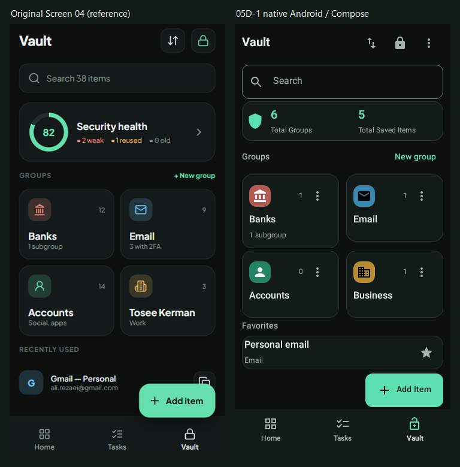

# Phase 05D-1 Visual QA

Date: 2026-10-21. final result: passed

No actionable P0/P1/P2 finding remains within the approved dashboard scope. Owner visual approval and physical-device/accessibility QA are still outstanding.

## Evidence And Normalization

- Source: `docs/phase04a/references/02-vault-details-editor.png`, leftmost Screen 04. Original source inspected before implementation.
- Implemented screen: `vault-dashboard-dark-en.png` and EN/FA/light/nested/responsive states in this folder. Production VaultScreen uses actual repository authentication with synthetic fixtures; `FLAG_SECURE` remains enabled.
- Combined comparison input inspected: [vault-dashboard-reference-comparison.png](vault-dashboard-reference-comparison.png).
- Source app-content crop: `(16,88,356,715)`, scaled by width to 360x723. Implemented comparison viewport: native 360x723dp at mdpi/1x text. Composite: 768x779. No status/gesture/device-frame differences are counted as app-layout findings.
- Regular portrait captures: 360x778. Narrow/large text: 320x640 at 200%. Landscape: 640x360. Wide: 1000x850. Native Robolectric SDK 28 rendering, not browser/device/emulator screenshots.
- Fixture states: six actual groups (four root, one child, one grandchild), five actual records, one favorite, with synthetic credentials never shown in dashboard previews. Reference counts/usage/health numbers are illustrative and intentionally not reproduced.
- Full-resolution individual captures were also inspected for typography, folder/count/menu spacing and final-row clearance. Text is readable at 1:1, so an enlarged or retouched detail crop was unnecessary.

## Findings And Fidelity Surfaces

| Surface | Final assessment |
| --- | --- |
| Typography | Existing Vazirmatn weights, 20/16/14/12sp hierarchy and zero tracking retained. Text wraps at large scales rather than shrinking. The mock's exact font/rasterization is not asserted to be identical. |
| Spacing/layout | Source visual order retained. Compact real-count row, two-column root cards, lower Favorites, extended mint Add Item and persistent tabs. Cards stack below the safe width/above 1.3 text scale. The final favorite is visible at the 360x723 comparison height with separate action clearance. |
| Colors/tokens | Approved charcoal/neutral surfaces, mint action/count accents and subtle borders. Real stored category colors are retained as small contrast-safe icon tiles; neutral text remains readable for very pale/dark colors. Light compatibility uses existing tokens, not inverted image assets. |
| Images/icons | Native Material icons and approved reusable components. No AI-generated UI, remote favicon/branding, imaginary credential preview, new artwork or simulated metric. Solid contrast-safe category tiles differ from translucent mock tiles intentionally. |
| Copy/content | Real totals replace the unsupported 82 health score. Favorites replace Recently Used; no modifiedAt mutation on open. Group names/counts and category-only record previews are real fixture data, not copied personal-looking account values from the mock. |
| Interaction | Search, sort/tag/favorite/reset, folder navigation, management, View All when preview is incomplete, Add Item, lock and menu actions have actual callbacks. No inert controls. Child menu/favorite actions remain separate from opening their parent card. |
| Responsive/RTL | EN/FA and light renders reviewed. Large text stacks cards, grows captions, mirrors logical actions and scrolls. Wide tree and short landscape remain navigable; scrolled frames verify access to the last record above the action region. |
| Accessibility | Target checks pass at >=48dp, including category-tree controls. Count semantics distinguish direct card contents from global totals. Native text-layout checks pass; RTL combining-mark intrinsic-width metrics are unreliable and receive pixel review instead. Actual TalkBack and real keyboard/IME operation remain device QA gaps. |

## Comparison History

1. First render: overview/header/section spacing pushed Favorites below the visible action region at the shorter reference height. Classified **P2 density mismatch**. Fixed by a compact count-only overview, denser optional group/item card modes and showing View All only when a favorites preview is incomplete. No touch target or font was reduced to force a fit.
2. First responsive checks: inherited category-tree targets were too small. Classified **P2 accessibility issue**. Explicit 48dp bounds and non-shrinking text bodies now pass native target checks, including the wide layout.
3. Filter interaction checks found an unsettled wrap-content dialog. Replaced its dashboard-only presentation with explicitly bounded secure, scrollable dialog content; existing sort/tag/favorite semantics remain. Tests pass.
4. Test harness fixes: removed reentrant ActivityScenario access from composition; scoped selectors to distinguish a folder from a record's identical category label and a dialog option from its background. Secure-window protection was never disabled.
5. Final native captures regenerated after the fixes. The combined source/final comparison and individual states were opened and reviewed. Final full run: 259 passing tests, zero lint errors, unchanged 66 warnings, successful debug build/release-test compilation.

## Intentional Differences / Residual Polish

- Overview is smaller than the mock's fictional health card; truthful groups/items do not need a progress ring.
- Header contains an additional working overflow action for existing management/security/settings access. Shared tool/icon/navigation styling is retained rather than cloned as an isolated visual system.
- The lower item row retains the existing favorite operation, not a new secret-copy shortcut. It has no username/email preview or remote service logo.
- Add Item has reserved clearance; the reference visually overlaps its final record. The implementation intentionally does not copy that overlap.
- Existing wide category-tree utility colors, detail/editor/security layouts and settings styles remain outside this narrowly scoped pass. Minor inherited style differences are not hidden by the comparison.

## Gallery

| State | File |
| --- | --- |
| Dark English | [vault-dashboard-dark-en.png](vault-dashboard-dark-en.png) |
| Dark Persian | [vault-dashboard-dark-fa.png](vault-dashboard-dark-fa.png) |
| Light | [vault-dashboard-light-en.png](vault-dashboard-light-en.png) |
| Nested folder | [vault-folder-nested.png](vault-folder-nested.png) |
| Narrow / 200% English | [vault-dashboard-en-large.png](vault-dashboard-en-large.png), [scrolled](vault-dashboard-en-large-scrolled.png) |
| Narrow / 200% Persian | [vault-dashboard-fa-large.png](vault-dashboard-fa-large.png), [scrolled](vault-dashboard-fa-large-scrolled.png) |
| Wide | [vault-dashboard-wide.png](vault-dashboard-wide.png) |
| Landscape | [vault-dashboard-landscape.png](vault-dashboard-landscape.png), [scrolled](vault-dashboard-landscape-scrolled.png) |
| Reference comparison | [vault-dashboard-reference-comparison.png](vault-dashboard-reference-comparison.png) |

Eighteen unchanged native PNG outputs plus one labeled comparison; [artifacts.csv](artifacts.csv) lists all exact names, dimensions, hashes and provenance. Scrolled pairs verify reachability, not fabricated alternate layouts.

## Stop

Ready for visual review, not publication. No physical-device security certification, Vault unlock/detail/editor/generator redesign, storage change, commit or push. Phase 05D-2 requires separate owner authorization.
